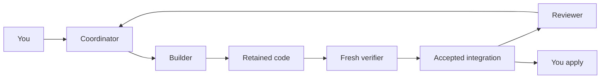
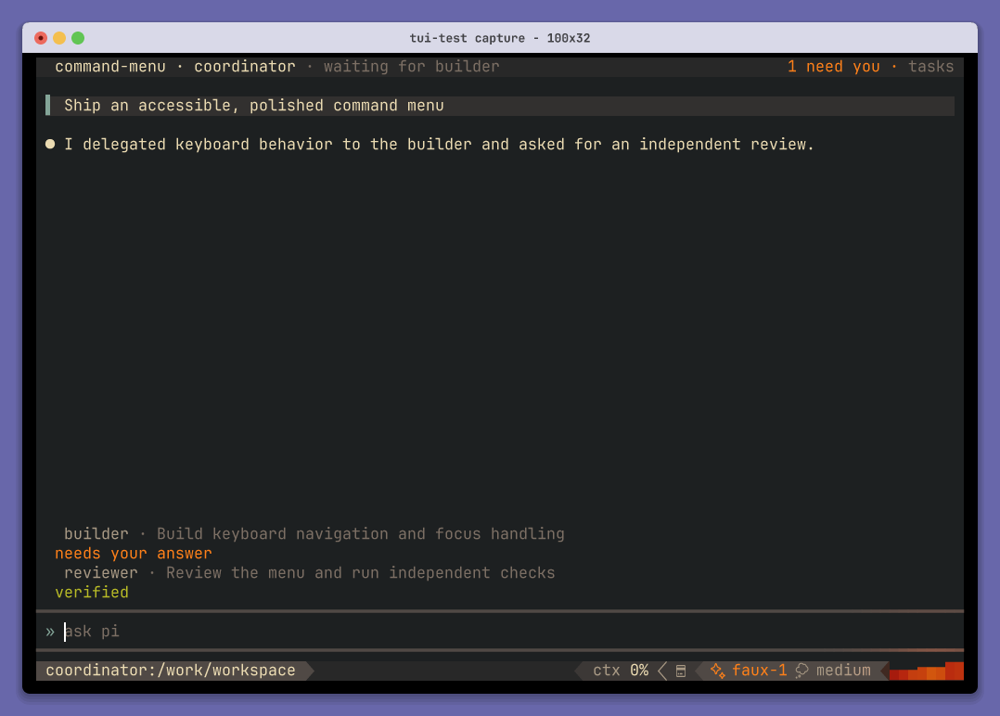
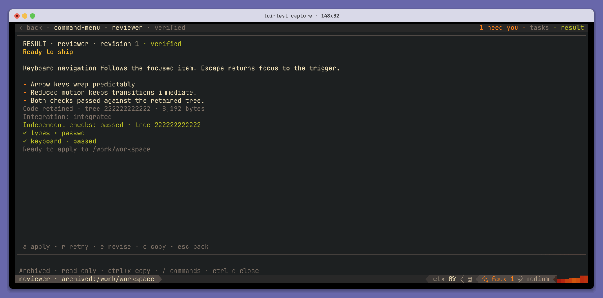

# Agents

**Describe the team. Give it an objective. Review what it brings back.**

An agent is an ordinary NixOS module with a role: instructions, a model, tools,
delegation permissions, and an execution environment. Pituitary gives it a durable
conversation on the host and a Bay machine for files and commands. Credentials
stay on the host.

[Meet the team](#meet-the-starter-team) · [Enable a host](#connect-the-team-to-a-host) ·
[First run](#give-it-a-small-real-task) · [Pituitary](../packages/pituitary) · [Bay](../packages/bay)

## Meet the starter team

[`default.nix`](default.nix) is a complete, importable team for a **Bun project with
a committed `bun.lock` and tests runnable with `bun test`**:

| Declaration | Job | Capabilities |
| --- | --- | --- |
| `coordinator` | Delegate implementation and arrange review | Read, search, and delegate |
| `builder` | Implement a change and submit retained code | Read, search, write, edit, and shell commands |
| `reviewer` | Read accepted code and report defects | Read and search; no write or shell tools |
| `verifier` | Execute checks in a fresh machine | Fixed commands; no model or credentials |



All four share a Bun image and warm base while getting separate session instances.
The builder's verification command installs locked dependencies and runs `bun test`.
The reviewer critiques code; the verifier produces independent test evidence.

Importing this attribute set does not start agents or enable host services. No team
is enabled on a Realm machine by default. Adapt its packages, instructions, and
checks to your project before enabling it.

## Connect the team to a host

The host needs NixOS with KVM, an existing operator account, and Bay's storage and
network setup. Start with [Bay's prerequisites](../packages/bay#set-up-a-host).
In Realm, a module such as `machines/reaper/pituitary.nix` can contain:

```nix
{ config, ... }:
{
  # Keep an existing hostId; this is Reaper's Bay host ID.
  networking.hostId = "91e0f444";
  services.bay.network.address = "10.80.0.1/24";

  services.pituitary = {
    enable = true;
    operator = config.my.user;
    model = "anthropic/your-model";
    credentialProfiles.primary = {
      provider = "anthropic";
      file = "/run/secrets/pituitary-api-key";
    };
    agents = import ../../agents;
  };
}
```

Replace `anthropic/your-model` with an available model ID. Provision the API-key file
through your secret manager and make it readable by the operator. Only the path
enters Nix configuration. The team grants `primary` to its three model roles;
individual roles can override the host model with `pituitary.agent.model`.

Import the new module from `machines/reaper/default.nix`, then apply that host's
configuration through your normal deployment workflow. The Pituitary module enables
Bay, generates the catalog, and starts `pituitary.service`. Allow the initial image
and warm base to finish, then open a fresh login shell for the host's client defaults:

```sh
systemctl status bay-base bay-server pituitary
pituitary agents
```

You should see `coordinator`, `builder`, `reviewer`, and `verifier`. The verifier's
catalog entry does not make it a model-driven teammate.

Outside Realm, import `inputs.realm.nixosModules.pituitary` and assign your copy of
the team's attribute set to `services.pituitary.agents`. The import path above is
relative to `machines/reaper/`.

## Give it a small real task

On the host, enter a Bun Git project with a lockfile and working tests. Name a real,
bounded issue you can review:

```sh
cd /path/to/project
pituitary run --agent coordinator --name first-change --workspace "$PWD" \
  'Fix the empty-input parser bug, add a regression test, and have the change reviewed'
```

`--workspace` captures tracked files as they are now, including staged and unstaged
edits. Add an untracked file deliberately with `--include-untracked PATH`. Each
writer gets an isolated checkout; your branch, index, and working files stay unchanged.

Watch the coordinator delegate to the builder, wait for verification, and arrange
review. It can ask you for a decision. The run freezes the model, role definitions,
and verification policy it started with.



*Terminal capture of the deterministic team UI scenario. Messages and statuses are
fixture data, not evidence of a live-model run.*

## Follow the work

| You want to… | In the terminal | From the CLI |
| --- | --- | --- |
| Browse teammates and results | `ctrl+k` | `pituitary inspect first-change` |
| Answer a question | `ctrl+q` | `pituitary answer QUESTION 'Your answer'` |
| Return to the coordinator | `alt+left` | `pituitary attach first-change` |
| Join a teammate | Open it, then `alt+i` | `pituitary attach first-change --task TASK` |
| Leave it working | `ctrl+d` | Start with `--detach` |
| Cancel the run's work | — | `pituitary stop first-change` |

`pituitary runs` lists runs. `inspect` shows task IDs, current revisions, questions,
failures, and result identities; `--json` gives the complete detail. Opening a teammate
in the UI observes it until you explicitly join its input lease.

For another attempt or a refined objective, take the task ID and **current revision**
from `inspect`. Choose the command that matches your intent:

```sh
pituitary retry TASK --revision N
pituitary revise TASK --revision N --accept 'Reject empty input' \
  'Handle empty input and cover it with a regression test'
```

Revising advances the revision and invalidates dependent results. `--depends-on TASK`
and `--accept CONDITION` replace their lists when supplied; `--clear-dependencies`
and `--clear-acceptance` clear them. `pituitary integrate TASK --revision N` queues
integration. `pituitary recover RUN` retries parked workflow phases using saved
identities. After an uncertain mutating command, reuse its printed `--command-id`.

Remote frontends can [attach through SSH](../packages/pituitary#connect-from-another-machine).
Start workspace captures on the host: the path names a host directory.
`--repo OWNER/NAME@REF` adds repository context; those checkouts are writable, but retained
code comes from the primary `--workspace`.

## Bring the code back

Pituitary distinguishes reports, retained code, integration, and verified code.
A successful paragraph does not advance a result through those stages. Independent
checks run against the exact integrated tree in a fresh verifier instance.



*Deterministic UI fixture of the evidence view; hashes and check results are illustrative.*

Review the result, then apply it on the host:

```sh
pituitary inspect first-change
pituitary apply first-change
git diff
```

Apply requires current passing verification and an unchanged source checkout. It
preserves your branch and index; review, commit, and push through your usual workflow.
If your input changed while the team worked, apply refuses it. A report-only run has
no code to apply; missing verification policy leaves code unverified.

## Make the declarations your own

Start with [`default.nix`](default.nix). Each entry is a NixOS module, so use imports,
packages, and services just as you would for a machine. Keep role instructions beside
those dependencies, inline or in a file read with `builtins.readFile`.

| Declare | Meaning |
| --- | --- |
| `environment.systemPackages`, imports, services | The actual execution environment |
| `pituitary.agent.instructions` | Role instructions kept on the host |
| `pituitary.agent.model` | Override of the host model |
| `pituitary.agent.tools` | Coding tools; `bash` allows arbitrary commands as the guest user |
| `pituitary.agent.delegatesTo` | Roles this agent may create child tasks for |
| `pituitary.agent.credentials` | Named host API-key profiles the role may use |
| `pituitary.agent.limits` | Delegation depth and child count |
| `pituitary.agent.verification` | Verifier environment and named checks required to accept code |

For another project, change the builder's check command and put its dependencies
in the verifier's environment too. Commands are fixed argument vectors; use an
explicit shell, as the starter does, when you need `&&`. Dependency installation
must work in a fresh machine without guest credentials or host `node_modules`.

The host's `services.pituitary.limits` bounds tasks, concurrent attempts, delegation
depth, duration, reports, and artifacts. Bay separately limits running sessions and
their total reserved memory.

Instructions, models, tools, and checks live outside images. Regenerate the catalog
to make edits available to new runs without rebuilding a machine. UI changes can
[reload only the frontend](../packages/pituitary#develop-without-rebuilding-the-system).
Machine package or service changes rebuild the affected image. Runs retain frozen
role and machine identities.

## When something needs attention

| Symptom | Where to look |
| --- | --- |
| No agent catalog | Enable the host module and open a fresh login shell; Home Manager alone installs the client |
| Model or credential rejected | Use an available model ID, grant `primary`, and make its key file readable by the operator |
| Environment unavailable | Inspect `bay-base`, `bay-server`, and the declared image |
| Waiting for capacity | Compare run limits with Bay's session and memory limits |
| Checks failed | Open the result for named check output and the tested tree |
| Code unverified | Declare a policy matching the project; model test claims do not count |
| Apply refused | Check current verification and whether the original checkout changed |

For host logs, use `journalctl -u pituitary -u bay-server -u bay-base`.
The [role options](../packages/pituitary/agent-module.nix),
[host module](../modules/system/nixos/pituitary.nix), and
[architecture](../packages/pituitary/docs/orchestration.md) provide the deeper reference.
