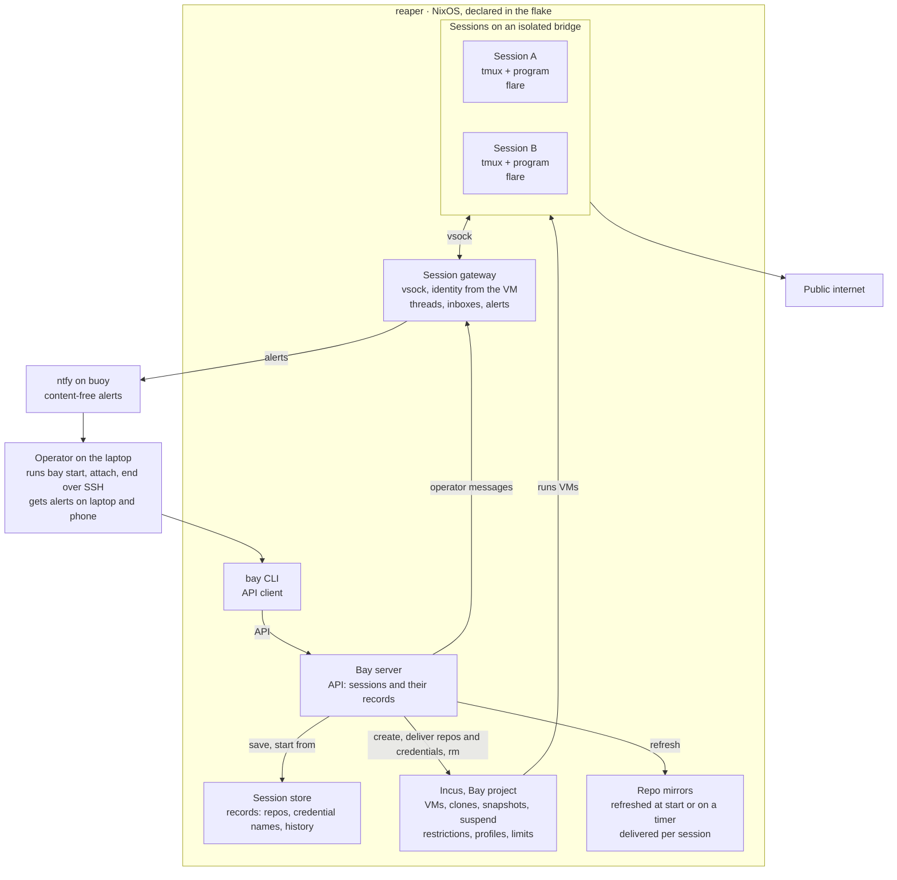

# Bay: self-hosted agent sessions on the workstation

Oct 5, 2026 · @Glib Shpychka

## Summary

Bay runs disposable, isolated VM sessions for terminal programs, including coding agents, on reaper, a headless NixOS workstation (i9-14900K, 96 GB RAM) the operator reaches over SSH from a laptop. A session starts from a warm base with the repos and credentials it needs, and can notify the operator and message other sessions. A session can be suspended with its memory and resumed where it was, or ended and started again later from its record of repos, credentials and program history.

The platform is a package and NixOS module in Realm, configured by reaper; sessions are runtime state, kept outside Nix.

## Desired outcomes

The operator launches a ready-to-use session in seconds, works in it from the terminal, and removes it without leftovers. The launch-time target gets its number from phase 1 measurements.

| Need | Outcome |
| --- | --- |
| Launch | One command, or one click in the optional app, creates a session. It is ready to attach within seconds of launch (target set after measuring). |
| Agnostic | Sessions run any terminal program. The platform works with any agent or CLI. |
| Repos | The operator picks repos per session. They arrive cloned at a fixed path, delivered from host mirrors for speed. A session receives only its own repos. |
| Credentials | The operator picks which of their own tokens and keys a session gets; the copies live in its instance and go with it. |
| Interaction | The operator attaches from their own terminal to a persistent tmux session and can detach without stopping work. |
| Notifications | Sessions alert the operator on laptop and phone when done, blocked or idle, by explicit command or automatically through hooks. |
| Messaging | Sessions exchange threaded messages under their session names. The operator can read every thread and message any session. |
| Suspend and snapshot | A session can be suspended with its memory and resumed where it was, snapshotted and rolled back. Running sessions carry on across a reaper reboot. |
| History | Ended sessions stay listed with their program history, and any of them can be started again from its record: its repos at their commits, its credentials and its history. |
| Teardown | One command removes a session, its record and everything it was given. |
| Configured in code | Host, network, images, profiles and services live in the flake. A rebuild reproduces the platform, guest image and warm base included. |
| Isolation | A session holds copies of only the files and credentials it is given. It reaches the host through one gateway, other sessions through messaging, and the public internet directly. |
| App (nice to have) | A web view to launch, list and remove sessions, opened from the operator's laptop. |

## Stack

Incus runs the sessions, the flake defines everything around them, and two small components written for this project tie them together: the Bay server, whose API the `bay` CLI and the app call, and the session gateway.

| Layer | Choice | Why |
| --- | --- | --- |
| Host | NixOS on reaper, configured from its system flake with Bay's module | The whole platform is declared and reproducible. |
| Session engine | Incus VMs in a dedicated Incus project | Copy-on-write clones, stateful stop, snapshots with memory, CLI and API. Project restrictions hold the isolation invariants for every instance in it. |
| Storage | ZFS pool, loop-backed for phase 1, then on a dedicated partition | Instant copy-on-write clones of VM volumes. reaper's root filesystem is ext4, where Incus copies every instance in full. |
| Guest image | NixOS VM image built from the flake | What runs inside a session is versioned code. |
| Bay server | Host service with an API, new; the `bay` CLI and the app are its clients | One place owns session logic for every client. Incus is the source of truth for sessions with an instance; the server's store keeps every session's record. |
| Session gateway | Small host service, new | The one host endpoint sessions reach. It ties every call to the calling session's identity. |
| Messaging | Threads and inboxes in the session gateway, served over MCP and `flare` | Identity comes from the VM, so the store needs no identity scheme of its own; the operator reads and writes through the Bay server. |
| Notifications | ntfy, the existing instance on buoy | The operator's laptop and phone subscribe; alerts are content-free. |
| Interaction | tmux inside each session | Persistent, detachable, terminal-native. |
| Network isolation | Incus NIC ACLs, port isolation and address filtering | Sessions reach the public internet; the host, the LAN, the tailnet and other sessions sit outside their ACLs. |
| Language | Go for the Bay server, the gateway, the `bay` CLI and `flare` | Incus publishes its own Go client library, and `flare` ships into the guest as one static binary. |
| App (optional) | A web client of the Bay server's API | Launch, list and remove without a terminal, through the same operations as the CLI. |

## Architecture

Everything except alerts runs on reaper: the operator drives the Bay server through the `bay` CLI over SSH, the server drives Incus and the host services, and sessions reach the host through the gateway and the internet directly.

The Bay server delivers repos and credentials into each session through Incus. The gateway learns which VM is which session from the Bay server and answers only live sessions.

## Components

Each component owns one concern, and the Bay server holds the session-level logic. How each is built is the implementer's call within the constraints below.

### Flake interface

- Realm contains the NixOS module for the host platform, the `bay` and `flare` packages and the guest image builder, all developed together.
- The consumer supplies nixpkgs through `follows`, the host's settings (storage dataset, bridge subnet), the ntfy token from its secret store, and the agent CLIs baked into the guest image together with the lifecycle hooks that call `flare notify`.
- The guest image builds from the consumer's nixpkgs and moves with the consumer's lock. On activation the host imports a changed image and rebuilds the warm base.

### Host platform

- Declares the Incus server config (storage pool, managed bridge, the Bay project and its profiles), the gateway, mirror refresh and the firewall.
- Incus on NixOS requires the nftables firewall backend, and Incus enforces ACLs through nftables. reaper's one custom iptables rule, the realtime voice allowlist, moves to nftables with this platform.
- The Bay project admits Incus-managed disks and NICs only, and no GPU, PCI, USB or proxy devices, and no nested virtualization. It admits low-level VM options, because Incus counts the host-shutdown action that suspends sessions among them. Host files reach sessions as copies.
- Each session NIC carries ACLs, port isolation and IP and MAC filtering: a session reaches the public internet and the bridge's DHCP and DNS, under the address Incus assigned it.
- The Incus API stays on its local socket.
- Profiles carry resource limits. reaper also serves distributed Nix builds and GPU AI services, and the Bay server's cap on running sessions leaves room for them, counting each session at its full memory limit. Suspended sessions sit outside the cap.

### Guest image

- Built from the flake. Contains tmux, git, `flare` (the in-session command), the agent CLIs the consumer selects, and MCP config pointing at the gateway.
- Root has no password and sshd is off; the nixpkgs Incus guest module defaults to an empty root password with on-demand sshd.
- The warm base is the image booted once with first-boot work done, then stopped. Each start is a copy-on-write clone of it that cold-boots, since Incus restores a VM's memory only under its original name. Per-repo bases with dependencies installed are an optimization, measured against the launch target.
- Secrets arrive at each start as files, outside the image and outside instance config.

### Programs

- Each program has a definition in the flake: its launch command, its resume command and the paths that hold its history.
- A program without a definition launches fresh on every start.
- A program with a definition launches in resume mode when a session starts again with history in its record, and when `resume` starts it again inside a running session.

### Bay server

- Owns sessions and their records, and exposes them through an API on a Unix socket on reaper that only the operator's user can open. The `bay` CLI and the optional app are its clients; the app reaches it from the laptop over SSH.
- Operations: `start` (a new session, or an ended one from its record), `attach`, `list`, `suspend`, `snap`, `resume` (from suspended memory, rolled back to a snapshot, or the program started again after it stopped), `end`, `rm`, plus reading threads and sending messages.
- Every session has a record in the host's session store: its program, the repos it can access and the commit each has checked out, the credentials it gets, and the program's history. Listing reads the store. See [ADR 0001](adr/0001-sessions-are-host-side-records.md).
- Running and suspended sessions also carry their record ID on the instance as a `user.*` key. The Bay profile turns the Incus guest API off, which keeps instance config host-side.
- `start` writes the session record, clones the base, delivers repos and credentials, and launches the program in tmux. A failure at any step rolls everything back.
- Ending a session saves the program's history into its record and deletes the instance. Starting an ended session boots a fresh instance from the current warm base, delivers its repos at their commits and its credentials, restores the history and launches the program in its resume mode.
- `rm` deletes the session's instance and record.
- Packaged in the flake and written fresh.

### Repos

- The host keeps a mirror of each repo the operator picks for a session. Private repos refresh at each start with the session's credentials; a timer refreshes the rest.
- Each start delivers each of the session's repos from its mirror into the guest through Incus, at the commit in the session record, then points it at the real remote. Mirrors stay on the host, so a session holds only its own repos.
- Every session clones to `/work/<owner>/<repo>`, so program history tied to a directory stays valid when a session starts again in a fresh instance, and same-named repos from different owners stay apart.

### Credentials

- The operator's own tokens and keys, picked per session, with the scope and lifetime the operator sets. Copies arrive as files in the session's instance and go with it.
- The session record names the credentials a session gets, the operator supplies them at each start, and saved history holds no credential files.
- Model provider access is the operator's subscription. The operator signs in inside each session through the agent's terminal login, completing the printed URL in the laptop's browser. The sign-in's token lives in the session's instance and goes with it, so each start signs in again; the warm base holds none.

### Session gateway

- The one host endpoint sessions reach, over vsock. Incus assigns each VM's vsock address; the gateway maps the caller's address to its session, so identity needs no secret in the guest. It answers only live instances in the Bay project.
- Owns messaging: threads and inboxes in its own database, served to sessions as MCP tools and through `flare`. Every message carries the calling session's name as its sender.
- Publishes each session's alerts to ntfy, and alerts the operator when a message is addressed to them.
- Runs as its own service, apart from the Bay server, and holds only its ntfy token. It learns which session owns which vsock address from a read-only socket the Bay server serves to it, and it has no Incus access. The Bay server reaches the message store over a local socket for the operator's reads and writes.

### Messaging

- Sessions exchange threaded messages under their session names. Any session can message any other, and the operator reads every thread and messages any session through the Bay server.
- Agents use the gateway's MCP tools; other programs use `flare`.
- Threads and inboxes key on the session's record ID, so a session started again keeps them, and a later session that reuses a removed session's name starts with an empty inbox.

### Notifications

- Alerts publish to the existing ntfy on buoy (deny-all access, per-publisher tokens); the operator's laptop and phone subscribe.
- Alerts leave reaper, so they carry the session name and event kind only.
- Triggers: an explicit `flare notify`, agent lifecycle hooks, and tmux bell or silence monitoring for programs without hooks.

### Interaction and app

- Each session runs one tmux server. `bay attach` asks the Bay server which instance backs the session and runs `incus exec` into its tmux from the operator's terminal on reaper; attaching is terminal-only.
- The optional app binds to localhost on reaper, is opened from the laptop over SSH, and is a client of the Bay server's API.

### Suspend, snapshots and reboots

- Every session runs in Incus stateful mode, which admits Incus-managed disks only and reserves state space on the root disk at least the size of the session's memory.
- Suspending a session stops its instance with memory saved, and resuming carries on where it was. A suspended session holds disk space and no RAM.
- When reaper shuts down, every running session is suspended, and it resumes when reaper boots.
- After a crash Incus boots each running session's instance without its memory, and `resume` starts the program again, from the history on the instance's disk when the program keeps one.
- Restoring a snapshot rolls the guest back. Host-side state (messages, mirrors) stays current.
- Rolling back to a snapshot deletes the snapshots taken after it, once the operator acknowledges them.
- Snapshots live on the instance, so ending a session deletes them with it, once the operator acknowledges them. Suspending keeps them.

## Security and data

Sessions run untrusted code with real credentials and direct internet access on a machine that also holds the operator's other logins. The design therefore limits what each session holds and what it reaches beyond the public internet.

- **Credentials**: the operator chooses which of their own tokens and keys a session gets. Passwords, 2FA codes, authenticator seeds, browser cookies and stored logins stay out of sessions.
- **Operator-launched**: the operator launches every session and supplies every credential. Background mirror refresh runs without credentials.
- **Local services**: the Incus API and the Bay server's API use local sockets, the gateway listens on vsock and on a local socket for the Bay server, and the app on localhost.
- **Personal data**: creator and user data (names, emails, earnings, messages) enters a session when the task needs it, at the least detail that works, such as user IDs or grouped bands.
- **Session records**: saved program history holds whatever the session saw; the store stays on reaper, and `rm` deletes a session's record.
- **Messages and alerts**: personal data stays out of messages, which the gateway keeps on the host, and out of alerts. The message store gets a retention period.
- **Untrusted input**: messages from other sessions are treated as data. Credentials, launches and host actions stay with the operator and the Bay server.
- **Leaked secrets**: a secret seen in output, logs or messages is masked and reported to the operator, who rotates it.
- **Audit trail**: session launches and teardowns with the credentials each session got, and gateway calls by session and tool, are logged with who, what and when, with secrets masked.

## Phases

Usable sessions with their records come first, then repos and credentials, then messaging, then suspend and snapshots.

| Phase | Delivers | Done when |
| --- | --- | --- |
| 0. Decisions | Choices from Open questions recorded | Decisions written into this doc |
| 1. Core sessions | reaper on nftables with its existing services working; loop-backed ZFS pool; the Bay project, bridge, NIC isolation and profiles; guest image and warm base; the Bay server with its session store, `start`, `attach`, `list`, `end`, `rm`, and the `bay` CLI; records hold the program's history | A session launches and attaches; an ended session starts again with its history; it reaches the internet and none of the host, LAN, tailnet or other sessions; launch time is measured and a target set; `rm` removes every trace |
| 2. Repos and credentials | Repo mirrors and per-session delivery; per-session credential delivery; repos and credentials in the session record; rollback of a failed `start`; audit log for launches and credentials | A session pushes a branch to a private repo with the operator's credentials; an ended session starts again with its repos and credentials |
| 3. Messaging and notifications | Session gateway with its message store and MCP tools, ntfy alerts, `flare`, hooks | Two sessions exchange a threaded message; the operator gets an alert on laptop and phone when a session finishes or idles; a session fails to send as, or read the inbox of, another session |
| 4. Suspend and snapshots | Suspend and resume, including across reboots; memory snapshots and restore | A suspended session resumes where it was; a reaper reboot resumes running sessions; a snapshot restores a running session |
| 5. App (optional) | Web client of the Bay server's API | Launch, list and remove work from the laptop's browser |

## Open questions

Phase 0 settles these.

- [x] **Bridge**: Incus-managed, since NIC ACLs, port isolation and IP filtering need it.
- [x] **In-session transport**: vsock through the gateway. VM proxy devices support TCP and UDP NAT only, and vsock gives the gateway the caller's identity with no secret in the guest.
- [x] **Image updates**: the guest image follows the consumer's nixpkgs; the host imports a changed image on activation and rebuilds the warm base.
- [x] **Containers**: sessions holding credentials run as VMs, since containers share the host kernel. A container profile stays possible for trusted tasks without credentials.
- [x] **Phone alerts**: the existing ntfy on buoy relays them.
- [x] **Model access**: the operator's subscription, signed in per session through the agent's terminal login.
- [x] **Credentials**: the operator's own tokens and keys, picked per session and delivered as files at each start.
- [x] **Storage**: a loop-backed ZFS pool on the ext4 root carries phase 1 measurements; the pool moves to a dedicated partition before daily use.
- [x] **Incus config**: NixOS preseed with a reconcile step, both inside the rebuild. Preseed creates the pool, bridge and project and merges their config; the reconcile step writes the session ACL and the Bay profile whole and deletes the project's other profiles.
- [x] **Sizing**: 4 vCPU and 8 GB per session, at most 8 concurrent sessions (64 GB). vCPUs float across host cores; phase 1 measurements decide whether sessions pin to the E-cores (CPUs 16-31).
- [x] **Coder**: set aside; see [ADR 0002](adr/0002-own-server-over-coder.md).
- [x] **Message store**: the gateway's own, with Agent Mail set aside; see [ADR 0003](adr/0003-messaging-in-the-gateway.md).

## Risks

The biggest risks sit at the session boundary: one session posing as another, and instructions smuggled in through messages.

| Risk | Mitigation |
| --- | --- |
| One session poses as another | The gateway derives identity from the VM's vsock address; spoofing is tested in phase 3 |
| Prompt injection between sessions | Messages are treated as data; credentials, launches and host actions stay with the operator and the Bay server |
| Moving reaper's firewall to nftables disrupts its existing services | Migrated and verified in phase 1, ahead of Incus networking |
| Snapshot restore with memory misbehaves | Restore tested in phase 4; disk snapshots as fallback |
| Many sessions contend for CPU, memory and disk | Profile limits and a concurrency cap that counts full memory limits |
| The Bay server grows into a general tool (code-on-incus is about 50k lines of Go) | The server stays thin; new capabilities land as separate components |

## References

- [Incus documentation](https://linuxcontainers.org/incus/docs/main/): instances, projects and restrictions, network ACLs, storage drivers, snapshots.
- [Incus on the NixOS wiki](https://wiki.nixos.org/wiki/Incus): host setup and building NixOS guest images.
- [ntfy documentation](https://docs.ntfy.sh/): publishing, access control and subscriptions.
