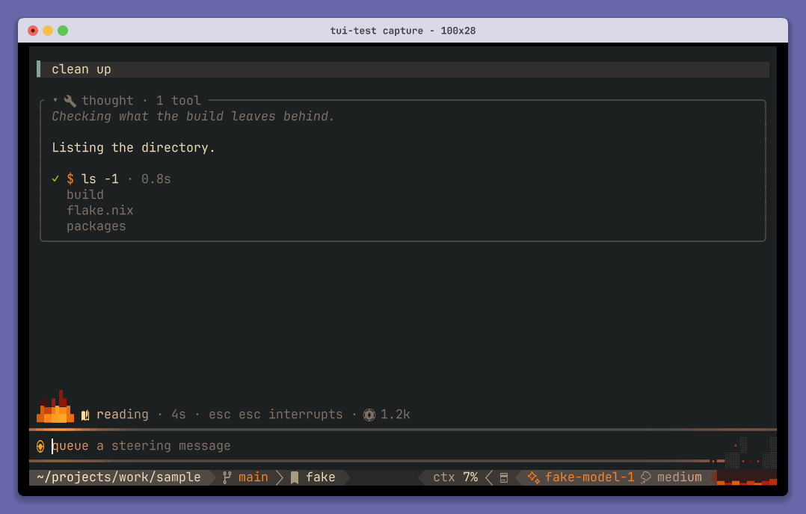

# Pituitary

**Your terminal interface for Pi and Dura.**

A conversation, an editor, a little fire. Work directly with your configured Pi,
or use the same interface to follow a durable team running in Bay machines.

[Start](#start-a-conversation) · [Sign in](#connect-your-provider) · [Teams](#connect-to-dura) ·
[Make it yours](#make-it-yours) · [Develop](#develop-without-rebuilding-the-system)



*Capture from a deterministic terminal scenario; no provider request.*

## Start a conversation

From your project:

```sh
pituitary
pituitary 'Explain how this project fits together'
pituitary --model openai-codex/gpt-6.1-sol
```

From a Realm checkout, `nix run .#pituitary` runs the packaged frontend. From another
project, use `nix run /path/to/realm#pituitary -- 'Your task'`.

Plain Pituitary starts Pi over its RPC interface. Pi owns your settings, providers,
extensions, prompts, tools, and saved sessions; Pituitary owns the terminal. It
prefers your configured `pi` on `PATH`, with a pinned Pi included as a fallback.
`PI_AGENT_CMD` selects an explicit executable. Pi's CLI flags pass through.

Choose a model with `/model` or `ctrl+l`. Send with `enter`, add a newline with
`shift+enter`, and queue a follow-up with `alt+enter`. `ctrl+d` closes the frontend
and its Pi process. Pi saves the session; the exit message gives a resume command.
Use `/new` for a fresh conversation and `/resume` to choose a saved one.

## Connect your provider

Start `pituitary`, type `/login`, and choose your provider. For a ChatGPT subscription,
choose the OpenAI subscription provider offered by your Pi version and complete
its browser sign-in. Then use `/model` to choose an available model. `/logout`
disconnects a provider.

With a ChatGPT subscription, `/fast` turns on [Fast mode](https://developers.openai.com/codex/speed):
replies arrive about 1.5× faster and draw on your subscription at a higher rate. The
footer marks the model with a bolt while Fast mode applies. Each conversation keeps
its choice, resumed ones included; a new conversation starts at standard speed.

Login and session selection temporarily open Pi's own screens on the current
session. Close that screen with `ctrl+d` to return to Pituitary. Authentication,
credential persistence, and token refresh remain upstream Pi responsibilities.
Provider API keys work through Pi's normal configuration too.

Over SSH, use the login screen's copy shortcut (`ctrl+x`) for the full URL. tmux
must allow application clipboard writes: `set -s set-clipboard on` (Realm configures
this). For manual selection in Ghostty, hold `shift` while dragging, then use `cmd+c`.

Drag to select and copy conversation text, including warnings, errors, queued
messages, and task results. Controls, keyboard hints, and decorative marks stay
outside the selection.

Standard extension dialogs, notifications, status text, widgets, commands, and prompt
completions appear in Pituitary. Extensions that render custom stock-terminal
components need Pi's interactive screen; that rendering API is outside Pi RPC.

## Connect to Dura

[Dura](../dura) is the durable harness. [Declare a team](../../agents), then run:

```sh
dura run --agent coordinator --name feature --workspace "$PWD" \
  'Implement the feature, have it reviewed, and return verified code'
```

Dura opens Pituitary on that run. Attach explicitly from another terminal:

```sh
pituitary --dura feature
# Or:
dura attach feature
```

State selection uses `--state DIRECTORY` first, then `DURA_STATE_DIR`, then
`$XDG_STATE_HOME/dura` (or `~/.local/state/dura` when `XDG_STATE_HOME` is unset).
`--socket PATH` (or `DURA_RUNTIME_SOCKET`) explicitly selects an existing host socket;
otherwise the client uses the local socket for the selected state directory.

The interface adds tasks, questions, results, and independent verification. Use
`ctrl+k` to browse tasks, `ctrl+q` for attention, and `alt+i` to join a teammate's
input lease. Closing this attachment leaves Dura's work running.

| Mode | Runtime and state | Configuration |
| --- | --- | --- |
| `pituitary` | Pi child process and Pi sessions | Pi settings, extensions, `/login` |
| `pituitary --dura RUN` | Existing Dura host and durable conversations | Declared agents and Dura host settings |

Both use the same editor, transcript, renderer, and presentation contract. Their
bootstrap, connection, and process lifetimes stay separate. Dura's
[architecture](../dura/docs/orchestration.md) explains authority and recovery.

## Make it yours

Import the [Home Manager module](../../modules/home-manager/pituitary.nix):

```nix
{ inputs, ... }:
{
  imports = [ inputs.realm.homeManagerModules.pituitary ];
  programs.pituitary = {
    enable = true;
    glyphs = "plain"; # or "nerd-font"
    footer.palette = "ember";
    keybindings."app.model.select" = "alt+m";
  };
}
```

Realm already imports it. The wrapper scopes editor, fire, colors, keybindings,
and logging preferences to Pituitary. `model` selects the regular Pi default;
`dura.stateDirectory` and `dura.socket` configure explicit Dura attachments.
The [NixOS Dura module](../../modules/system/nixos/dura.nix) declares the harness.

The draft embeds a clean Neovim and starts in insert mode. `ctrl+g` opens your
external editor; `PITUITARY_EDITOR`, `$VISUAL`, and `$EDITOR` select it.

| Key | Action |
| --- | --- |
| enter / shift+enter | Send / newline |
| alt+enter | Queue a follow-up |
| esc | Leave insert mode, then interrupt; close a picker |
| ctrl+l / ctrl+p / shift+tab | Choose model / cycle model / cycle thinking |
| ctrl+o / ctrl+t / ctrl+f | Expand work / toggle thinking / browse work |
| ctrl+g | Edit externally |
| pgup / pgdn | Scroll |
| ctrl+c twice / ctrl+d | Close |

`/` completes commands. `/hotkeys` shows your bindings. Local conversations complete
`@` paths and show the branch and GitHub pull request. `PITUITARY_GH=""` disables
the pull request lookup. `PITUITARY_STILL=1` holds animation; `PITUITARY_PLAIN_GLYPHS=1`
uses plain symbols. Runtime behavior follows negotiated capabilities. Protocol tests
cover Ghostty and tmux in Ghostty.

## Connect from another machine

Dura's host retains credentials and Bay environments. Ask it for its socket:

```sh
ssh host dura socket
ssh -NT -L "$HOME/.dura-remote.sock:/remote/runtime/socket" host
```

Replace `/remote/runtime/socket` with the first command's output. In another terminal:

```sh
pituitary --dura feature --state /var/lib/dura --socket "$HOME/.dura-remote.sock"
```

The state directory identifies the host state; an explicit socket avoids local
filesystem discovery. Start workspace captures on the host, where the files live.

## Develop without rebuilding the system

```sh
nix develop .#pituitary
bun install
cd packages/pituitary
just live
```

`just live` runs the frontend against regular Pi. For durable work, `just dura
attach RUN --watch` reloads the frontend after source edits while Dura keeps working.
`ctrl+r` requests the same reload. Drafts and viewports survive it.

For a provider-free interface demo, run `just run tool`. It uses a native Pi Durable
conversation and a scripted Faux model, without external requests or project edits.

| Path | Responsibility |
| --- | --- |
| [`packages/tui`](packages/tui) | Interface and isolated Pi/Dura adapters |
| [`packages/session`](packages/session) | Presentation contract, reducer, pacing |
| [`packages/ember`](packages/ember) | Fire and light primitives |
| [`../dura`](../dura) | Durable workflows, host API, CLI, Bay connector |
| [`e2e`](e2e) | Terminal scenarios and performance evidence |

Checks run in batches at major milestones. `just loop` writes its report, logs,
and screen captures under `artifacts`. Root `bun.lock` pins the workspace; the
production dependency hash lives in [`../agent-workspace.nix`](../agent-workspace.nix).
Renew it with a package build after changing dependencies.

Pituitary source, packages, modules, and issues are maintained in Realm.
