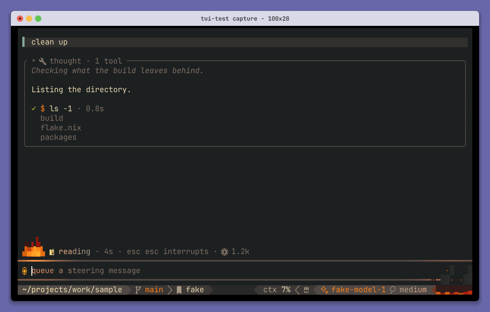

# Pituitary

**Your terminal interface for Pi and Dura.**

A conversation, an editor, a little fire. Work directly with your configured Pi,
or use the same interface to follow a durable team running in Bay machines.

[Start](#start-a-conversation) · [Sessions](#sessions) · [Skills](#skills) · [Sign in](#connect-your-provider) · [Teams](#connect-to-dura) ·
[Make it yours](#make-it-yours) · [Develop](#develop-without-rebuilding-the-system)



*Capture from a deterministic terminal scenario; no provider request.*

## Start a conversation

From your project:

```sh
pituitary
pituitary 'Explain how this project fits together'
pituitary --model openai-codex/gpt-6.1-sol
```

From a Realm checkout, `nix run .#pituitary` runs the packaged frontend. From another
project, use `nix run /path/to/realm#pituitary -- 'Your task'`.

Plain Pituitary starts Pi over its RPC interface. Pi owns your settings, providers,
extensions, prompts, tools, and saved sessions; Pituitary owns the terminal. It
prefers your configured `pi` on `PATH`, with a pinned Pi included as a fallback.
`PI_AGENT_CMD` selects an explicit executable. Pi's CLI flags pass through.

Choose a model with `/model` or `ctrl+l`. Send with `enter`, add a newline with
`shift+enter`, and queue a follow-up with `alt+enter`. `ctrl+d` closes the frontend
and its Pi process. Pi saves the session with its first message; the exit message then
gives a resume command, `pituitary --session <id>`.

## Sessions

Pituitary runs Pi's session commands itself, so the draft, its undo history, and the
screen stay where they are while the conversation changes under them.

| Command | Key | Does |
| --- | --- | --- |
| `/new` | `alt+n` | Start a new session |
| `/resume [all]` | `alt+r` | Switch to a saved session of this project, or of every project with `all` |
| `/fork` | `alt+f` | Start a new session from before an earlier prompt, that prompt in the draft |
| `/clone` | | Copy this session into a new one |
| `/export [path]` | | Write this session as an HTML page, into the directory Pi's process started in unless the path is absolute |
| `/reload` | | Reload Pi's extensions, skills, prompt templates, context files, and keybindings |
| `/session [copy]` | | Show the session's name, messages, context, cost, and file; `copy` copies the file's path |

The resume list puts the most recently changed session first and each fork under the
session it came from, with how long ago it changed and how many prompts it holds; the
session Pi has open reads `· current`. The filter matches names and first prompts. `ctrl+r` renames the session under the cursor,
`ctrl+x` deletes it, to the trash when a `trash` command is available, and `tab` switches
between this project's sessions and every project's; Pi's `app.session.rename`,
`app.session.delete`, and `tui.input.tab` keybindings rebind them. A project without saved
sessions lists every project's. A session from another project moves Pi, the footer, and `@`
completion to that project, and Pi's commands follow; Pi's process stays where it started.
`pituitary --resume` (`-r`) opens the list at start. Starting, forking, or resuming while Pi
works puts queued messages back in the draft and stops the run or compaction first, as Pi
does. A fork puts the earlier prompt in place of the draft; `esc u` brings the draft back.
As Pi's own, `/reload` asks to wait while a run or compaction is under way.

`/login`, `/logout`, `/settings`, `/scoped-models`, `/trust`, `/import`, `/share`, and
`/tree` open Pi's own screen on the current session while Pi is idle, with the command ready
to run on `enter`. `ctrl+d` on its empty editor, or `ctrl+c` twice, returns to Pituitary on
the session Pi ends on, with the draft and the conversation as they were. Pi reopens that
session at its last entry, so of a `/tree` move only one that leaves a branch summary
carries back; a move without one, and the prompt Pi puts in its editor, stay behind.

## Skills

Pi runs a skill from `/skill:name request`, which it expands into the skill's instructions
with the request after them. `/skills [filter]` or `alt+s` lists the skills Pi has loaded,
each marked `project`, `user`, or `this run` for one `--skill` loaded; picking one puts
`/skill:name ` before the draft, which becomes the request, replacing a skill the draft
already starts with. `/` completion finds a skill by its own name too, so `/pdf` offers
`/skill:pdf-tools`.

The draft shows a leading skill command as a chip. Pi expands only a `/skill:` at the very
start of the prompt that names a skill it has, reading the name up to the first space, so the
editor's rule warns when a `/skill:` would go to the model as typed.

In the conversation, the message shows the skill as a chip before the request; `ctrl+o`
shows the skill's file and the instructions the model received. Up recalls the prompt as
typed, and queued messages taken back into the draft and a fork's earlier prompt come back the
same way. A prompt template expands for good, so its prompt comes back as the text it became.
When the model reads a skill's file itself, its work says `used skill pdf-tools`.

## Connect your provider

Start `pituitary`, type `/login`, and choose your provider. For a ChatGPT subscription,
choose the OpenAI subscription provider offered by your Pi version and complete
its browser sign-in. Then use `/model` to choose an available model. `/logout`
disconnects a provider.

With a ChatGPT subscription, `/fast` turns on [Fast mode](https://developers.openai.com/codex/speed):
replies arrive about 1.5× faster and draw on your subscription at a higher rate. The
footer marks the model with a bolt while Fast mode applies. Each conversation keeps
its choice, resumed ones included; a new conversation starts at standard speed.

Login opens Pi's own screen on the current session; see [Sessions](#sessions) for the way
back. Authentication, credential persistence, and token refresh remain upstream Pi
responsibilities. Provider API keys work through Pi's normal configuration too.

Over SSH, use the login screen's copy shortcut (`ctrl+x`) for the full URL. tmux
must allow application clipboard writes: `set -s set-clipboard on` (Realm configures
this). For manual selection in Ghostty, hold `shift` while dragging, then use `cmd+c`.

Drag to select and copy conversation text, including warnings, errors, queued
messages, and task results. Controls, keyboard hints, and decorative marks stay
outside the selection.

Pasting an image puts a chip such as `image 1` in the draft. The prompt names the
image `[image 1]` and sends it along, and deleting the chip drops the image. Image
pastes need a terminal with the kitty clipboard protocol's paste events, such as
Ghostty 1.4 or kitty. Through tmux they need Realm's tmux, which relays them.

Standard extension dialogs, notifications, status text, widgets, commands, and prompt
completions appear in Pituitary, and a failing extension handler shows as a warning naming
the extension. A dialog with a timeout counts down in its border and says so in the
conversation when it cancels itself; `pgup` and `pgdn` scroll a long question. Extensions
that render custom stock-terminal components need Pi's interactive screen; that rendering
API is outside Pi RPC. Pituitary loads its own Pi extensions for Fast mode, provider usage,
and a bridge for what Pi's RPC lacks, such as listing sessions; they stay out of Pi's own
screens.

Models carry the names Pi's registry gives them, with `provider/id` beside them in
`/model`. Errors say what deals with them where they can, such as `/compact` for a full
context or `/login` for a refused credential; `ctrl+o` shows the rest of the error.

## Provider usage

The footer's credit-card icon opens usage for the selected provider credential. Click
it, press `alt+u`, or use `/usage` to open the details; `alt+u` or `/usage off` closes
them, as does `esc` (twice from insert mode) while nothing runs for it to interrupt, and
`/usage refresh` requests an update. Pi renames commands whose names collide, as
`/usage:1` and `/usage:2`; the card's hint names Pituitary's as Pi does. Without a
provider report, as in Dura, the card shows the session's estimated cost. Percentages
mean **used**. The panel keeps the session's estimated model cost separate from
provider-reported account usage.

| Credential | Provider-reported data |
| --- | --- |
| ChatGPT subscription through Codex credentials (`openai-codex`) | Available usage windows and resets, plan, extra-credit balance, model-specific limits |
| Sign in with ChatGPT (`openai`) | Usage-page link; this OAuth flow has no usage-read capability |
| Claude subscription | Five-hour and weekly windows, model-specific limits, monthly extra usage and cap when exposed |
| OpenAI / Claude API key | Limits and remaining requests/tokens from observed API response headers |
| OpenRouter key | Key spend, spending cap and remaining allowance, applicable member/workspace budgets, BYOK usage and free-model quota when exposed |

API response limits can be shared across models, projects, workspaces, or organizations;
they are not a personal billing balance. OpenAI and Claude inference keys do not expose
personal monthly spend or organization-imposed monetary caps here. OpenRouter's key
endpoint exposes the budgets that apply to that key; account-wide credit totals stay
outside this view. A credit balance alone does not establish credits spent.

Automatic account queries run at most once a minute per conversation, with a
15-second deadline, coalescing, and exponential failure backoff. Refresh respects
provider retry delays. API response limits update only when Pi receives headers; opening
the view never sends a paid inference probe. Dated observations remain visibly stale
after a failed refresh, two minutes without an update, or a passed reset. Reset times
do not imply a renewed allowance until the provider reports it.

Pi owns authentication and token refresh. Usage data stays in memory, outside the
conversation and model context. Subscription usage relies on internal endpoints that
can change or deny access to a particular OAuth client; unavailable metrics and errors
are explicit. Account queries use fixed provider endpoints and refuse redirects and
custom provider hosts. Passive API-header observations also work with custom API hosts.
This view belongs to regular Pituitary conversations; Dura attachments retain their
host-owned credential boundary.

Provider interfaces: [OpenAI rate limits](https://developers.openai.com/api/docs/guides/rate-limits),
[Claude rate limits](https://platform.claude.com/docs/en/api/rate-limits),
[OpenRouter key usage and budgets](https://openrouter.ai/docs/api/api-reference/api-keys/get-current-key).
The subscription adapters live in [`usage/providers.ts`](packages/tui/src/usage/providers.ts).
OpenAI's [token-sharing usage gap](https://github.com/openai/codex/issues/54219) applies
to Pi's current Sign in with ChatGPT flow. Pituitary links to the usage page without
polling an endpoint that rejects that credential.

## Connect to Dura

[Dura](../dura) is the durable harness. [Declare a team](../../agents), then run:

```sh
dura run --agent coordinator --name feature --workspace "$PWD" \
  'Implement the feature, have it reviewed, and return verified code'
```

Dura opens Pituitary on that run. Attach explicitly from another terminal:

```sh
pituitary --dura feature
# Or:
dura attach feature
```

State selection uses `--state DIRECTORY` first, then `DURA_STATE_DIR`, then
`$XDG_STATE_HOME/dura` (or `~/.local/state/dura` when `XDG_STATE_HOME` is unset).
`--socket PATH` (or `DURA_RUNTIME_SOCKET`) explicitly selects an existing host socket;
otherwise the client uses the local socket for the selected state directory.

The interface adds tasks, questions, results, and independent verification. Use
`ctrl+k` to browse tasks, `ctrl+q` for attention, and `alt+i` to join a teammate's
input lease. A narrow terminal lists the child tasks that need you first and counts
the rest. In a task's result, retrying (`r`) and applying to your workspace (`a`) each
take a second press. Closing this attachment leaves Dura's work running.

| Mode | Runtime and state | Configuration |
| --- | --- | --- |
| `pituitary` | Pi child process and Pi sessions | Pi settings, extensions, `/login` |
| `pituitary --dura RUN` | Existing Dura host and durable conversations | Declared agents and Dura host settings |

Both use the same editor, transcript, renderer, and presentation contract. Their
bootstrap, connection, and process lifetimes stay separate. Dura's
[architecture](../dura/docs/orchestration.md) explains authority and recovery.

## Make it yours

Import the [Home Manager module](../../modules/home-manager/pituitary.nix):

```nix
{ inputs, ... }:
{
  imports = [ inputs.realm.homeManagerModules.pituitary ];
  programs.pituitary = {
    enable = true;
    glyphs = "plain"; # or "nerd-font"
    footer.palette = "ember";
    keybindings."app.model.select" = "alt+m";
  };
}
```

Realm already imports it. The wrapper scopes editor, fire, colors, keybindings,
and logging preferences to Pituitary. `model` selects the regular Pi default;
`dura.stateDirectory` and `dura.socket` configure explicit Dura attachments.
The [NixOS Dura module](../../modules/system/nixos/dura.nix) declares the harness.

The draft embeds a clean Neovim and starts in insert mode. `ctrl+g` opens your
external editor; `PITUITARY_EDITOR`, `$VISUAL`, and `$EDITOR` select it.

| Key | Action |
| --- | --- |
| enter / shift+enter | Send / newline |
| alt+enter | Queue a follow-up |
| esc | Leave insert mode, then interrupt; close a picker, or the usage card while nothing runs |
| ctrl+l / ctrl+p / shift+tab | Choose model / cycle model / cycle thinking |
| ctrl+o / ctrl+t / ctrl+f | Expand work / toggle thinking / browse work |
| alt+r / alt+f / alt+n | Resume / fork / start a session (regular Pi) |
| alt+s | Choose a skill for the draft (regular Pi) |
| ctrl+g | Edit externally |
| alt+u | Show usage and cost |
| pgup / pgdn | Scroll |
| ctrl+c twice / ctrl+d | Close |

Like Pi's own `alt` keys, `alt+u` and `alt+s` take chords Neovim's insert mode reads as
`esc` then `u` or `s`. Where the terminal delivers a quick `esc u` as that chord, as one
without the kitty keyboard protocol may, it toggles the card instead of undoing; rebind
`app.usage.toggle` or `app.skills` if that bites.

`/` completes commands, marking Pi's skills, prompt templates and extension commands.
`enter` runs a command named in full and completes a half-typed one, as `tab` does; a
command that needs an argument, and a skill, complete to take one. `/hotkeys` shows your
bindings. Local conversations complete `@` paths, up to 50 matches, and show the branch and
GitHub pull request. `PITUITARY_GH=""` disables
the pull request lookup. `PITUITARY_STILL=1` holds animation; `PITUITARY_PLAIN_GLYPHS=1`
uses plain symbols. Runtime behavior follows negotiated capabilities. Protocol tests
cover Ghostty and tmux in Ghostty.

## Connect from another machine

Dura's host retains credentials and Bay environments. Ask it for its socket:

```sh
ssh host dura socket
ssh -NT -L "$HOME/.dura-remote.sock:/remote/runtime/socket" host
```

Replace `/remote/runtime/socket` with the first command's output. In another terminal:

```sh
pituitary --dura feature --state /var/lib/dura --socket "$HOME/.dura-remote.sock"
```

The state directory identifies the host state; an explicit socket avoids local
filesystem discovery. Start workspace captures on the host, where the files live.

## Develop without rebuilding the system

```sh
nix develop .#pituitary
bun install
cd packages/pituitary
just live
```

`just live` runs the frontend against regular Pi. For durable work, `just dura
attach RUN --watch` reloads the frontend after source edits while Dura keeps working.
`ctrl+r` requests the same reload. Drafts and viewports survive it.

For a provider-free interface demo, run `just run tool`. It uses a native Pi Durable
conversation and a scripted Faux model, without external requests or project edits.

| Path | Responsibility |
| --- | --- |
| [`packages/tui`](packages/tui) | Interface and isolated Pi/Dura adapters |
| [`packages/session`](packages/session) | Presentation contract, reducer, pacing |
| [`packages/ember`](packages/ember) | Fire and light primitives |
| [`../dura`](../dura) | Durable workflows, host API, CLI, Bay connector |
| [`e2e`](e2e) | Terminal scenarios and performance evidence |

Checks run in batches at major milestones. `just loop` writes its report, logs,
and screen captures under `artifacts`. Root `bun.lock` pins the workspace; the
production dependency hash lives in [`../agent-workspace.nix`](../agent-workspace.nix).
Renew it with a package build after changing dependencies.

Pituitary source, packages, modules, and issues are maintained in Realm.
