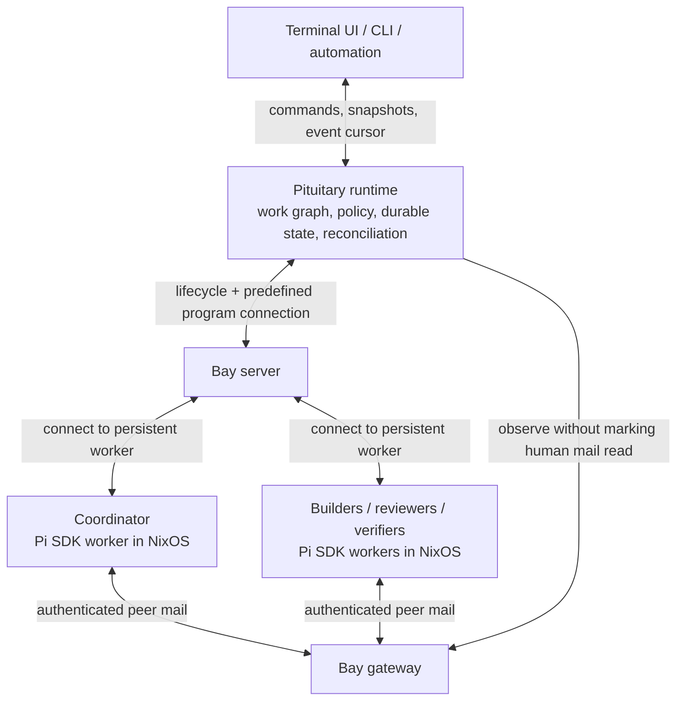

# Pituitary: a durable agent workspace

## Intent

Pituitary becomes a harness and orchestrator with an excellent terminal interface. An
operator gives it an objective, watches or joins the work at any depth, and receives a
reviewable, verified result. Work survives a detached terminal and a restarted frontend.
Agents have explicit environments, identities, authority, inputs, and outputs.

The declarations and everyday interface should be a pleasure to read. An agent is a
named, reusable NixOS machine definition with a role. Running work creates instances of
that definition. Nix describes the available machines and capabilities; the runtime
decides when to instantiate them within the operator's authorization.

This document is the implementation plan. Target interfaces below are proposals until
their milestone is implemented. Implementation progress belongs at the end of this file.

The standard is declarative truth with direct, deep abstractions. Machine and agent
declarations are source definitions; manifests are compiled outputs; the journal records
facts. Those roles must remain distinct. Prefer a small module that owns a complete
concern over layers that relay another module's methods. Add a seam when real behavior
varies across it, and remove machinery whose supported behavior no longer needs it.
Do not introduce a workflow language, plugin bus, or generic framework to express the
initial coordinator/worker lifecycle.

## What exists

- Pituitary has a polished OpenTUI frontend, a typed Pi RPC client, a transcript reducer,
  an extension UI bridge, a scripted agent, terminal integration tests, and performance
  budgets. Ordinary RPC use owns its agent process; managed UI connections attach to an
  independent persistent worker and detach on exit.
- `packages/tui/src/use-session.ts` owns execution synchronization inside React. The
  `AgentLink` interface and existing conversation rendering provide a migration seam.
- Pinned Pi 0.87.1 exposes `createAgentSession`, `AgentSession`, persistent native
  sessions, custom tools/messages, direct subscriptions, and session-scoped UI contexts.
  We can reuse its model loop while owning the surrounding harness.
- Bay owns isolated NixOS sessions, immutable repository starting revisions, saved
  program history, suspend/resume, snapshots, and an operator-only Unix-socket interface.
- Bay's gateway derives the sender from the live VM's vsock identity. It owns durable
  threaded mail and exposes it through MCP and `flare`.
- Bay selects declared machine images and allocations per program, pins them in session
  records, and prepares immutable warm bases shared by equal images and allocations.
  Programs define launch, resume, durable history, monitoring, and bounded connections.
- Bay exposes durable record, machine, and execution identities. The orchestration slice
  adds a non-marking forward mail cursor and retry-safe sends alongside human inboxes.
- Provider API-key profiles use private runtime delivery and in-memory worker storage.
  Workspace import/export is still planned. Ending a session
  saves selected program history and destroys unexported workspace changes.
- Bay is disabled in reaper's configuration; its configured program is Claude. Enabling
  it and measuring real resource/boot behavior are deployment work, not assumptions.

## Architecture and ownership



There are four deep modules, with internal folders where a separate package adds no value:

| Module | Owns | Does not own |
| --- | --- | --- |
| Run engine | Typed commands, identities, task transitions, dependencies, policy, acceptance | Terminals, Pi implementation, Incus |
| Runtime | SQLite state/journal/outbox, workers, reconciliation, Bay/local adapters, artifacts | Model reasoning, terminal layout |
| Worker | One Pi SDK runtime, native conversation, tools, scoped resources, connection, UI adapter | Host authority, global scheduling |
| TUI | Navigation, drafts, conversation projections, attention, display pacing | Execution lifetime, durable decisions |

The coordinator is an ordinary isolated worker with delegation tools. The trusted host
runtime is deterministic software. A model requests work; the runtime validates and
performs it. The human remains `operator`; autonomous coordinator messages keep the
coordinator's session identity.

Solo mode uses the same runtime and worker lifecycle. A local worker supports ordinary
trusted development and fast tests. Managed isolated work uses Bay. Start with rich Pi
support; advertise explicit capabilities for future engines. A terminal-only program
is still useful through Bay without pretending it supports steering or structured results.

## Agents as NixOS machines

Agent declarations co-locate their purpose, model, instructions, permitted delegation,
and actual NixOS environment. Shared modules make a family of agents easy to read.
The intended shape is:

```nix
services.pituitary = {
  enable = true;
  operator = config.my.user;

  agents = {
    coordinator = {
      imports = [ ./agents/base.nix ];
      pituitary.agent = {
        description = "Plan the work, delegate, and assemble a verified result.";
        instructions = builtins.readFile ./agents/coordinator.md;
        model = "anthropic/your-chosen-model";
        delegatesTo = [ "builder" "reviewer" ];
      };
    };

    builder = { pkgs, ... }: {
      imports = [ ./agents/development-machine.nix ];
      pituitary.agent = {
        description = "Implement one result from an exact input tree.";
        instructions = builtins.readFile ./agents/builder.md;
      };
      environment.systemPackages = [ pkgs.bun pkgs.go ];
    };

    reviewer = {
      imports = [ ./agents/development-machine.nix ];
      pituitary.agent = {
        description = "Find defects and challenge the evidence.";
        instructions = builtins.readFile ./agents/reviewer.md;
      };
    };
  };
};
```

Each entry is itself a NixOS module, with ordinary imports, packages, services, and
configuration. This keeps the machine declaration direct and readable. Shared guest
modules can provide the common toolchain:

```nix
{ pkgs, ... }:
{
  environment.systemPackages = [ pkgs.git pkgs.jq ];
}
```

The final option names should follow implementation evidence. These are real evaluated
NixOS systems built from Bay's guest module. A role without system differences can share
an identical image/base; prompts and models do not force image rebuilds. Machine-specific
dependencies produce distinct content-addressed images and warm bases. Existing Bay
programs keep working with the default machine.

Nix evaluation validates references and delegation targets and produces a resolved agent
catalog. Nix sets up packages, images, services, sockets, limits, and credential profile
references. Sessions, conversations, messages, run graphs, and live credentials stay in
runtime state. Transient attempts do not add machine files or require rebuilding NixOS.

Repository-supplied configuration is declarative data. Automatically evaluating arbitrary
repository Nix or TypeScript on the privileged host is outside the loading contract.
Trusted operator modules may define machine code explicitly.

## Work and identity

| Concept | Meaning |
| --- | --- |
| Run | One operator objective, input workspace, and authorized policy |
| Task | A result to produce, acceptance conditions, dependencies, and input revision |
| Attempt | One execution of a task; retries preserve earlier attempts |
| Agent definition | A named role, runtime configuration, authority, and NixOS machine |
| Bay session | A durable isolated environment record with a human-readable name |
| Worker incarnation | A host-authorized generation of a worker process |
| Native Pi session | The conversation bound to an attempt |

Names support navigation; immutable IDs establish ownership. Each attempt records task
revision, dependency artifact IDs, exact source tree, definition/configuration hash,
worker version, Bay record ID, worker incarnation, and native conversation ID.

Tasks can move through ready, executing, waiting, proposed, verifying, accepted, failed,
cancelled, and superseded states as appropriate. Worker connectivity and Bay session
state are separate facts: a disconnected agent is not automatically a failed task, and
an idle model is not proof that its task succeeded.

Native `/new`, `/resume`, tree movement, and fork operations become runtime-mediated in
managed work. A conversation branch does not rewind external effects or create a new
workspace. Viewing another agent changes the UI selection, not a task's conversation.

## Durable execution

Use one SQLite database for runtime state, a compact append-only domain journal, and a
transactional outbox. Bay continues owning its own mail database. Pi remains authoritative
for finalized model conversation history. Avoid permanently duplicating every token delta.

Commands have stable IDs, validated payloads, expected revisions, and recorded receipts.
Persist intent and state before dispatch. Repeated command IDs return the original
receipt; conflicting payloads are errors. Outbox effects are reconciled with existing
Bay sessions and worker receipts after restart.

The worker connection starts with a version/capability handshake and carries command IDs,
attempt IDs, incarnation, event sequence, and causal references. The worker keeps bounded
reconnect state and a durable command ledger. Live text can be coalesced; task transitions,
results, prompts, operator answers, and control receipts must remain recoverable. Slow UI
clients cannot block agent execution or cancellation. Capacity and disk exhaustion are
explicit states with bounded queues.

Arbitrary shell effects cannot honestly be guaranteed exactly once. A crash between an
effect and its recorded outcome produces an inspectable uncertain state. Recovery must
not blindly reissue a mutating prompt. Repeat only effects proven idempotent or explicitly
authorized as a new attempt.

Cancellation first revokes scheduling and acceptance authority, then aborts the worker,
then escalates through its environment if necessary. Late results remain history without
reviving cancelled work. Parent cancellation applies an explicit descendant policy.

Bay snapshots rewind guest memory/disk, while host messages, budgets, and runtime state
remain current. Restores and replaced workers require incarnation fencing. A stale worker
cannot complete a newer attempt or spend its authority.

## Agent communication and yielding

Peer conversations live in Bay. Add retry-safe message sends and a non-marking forward
cursor/feed. Runtime consumption never clears the operator's unread state. Distinguish
stored, delivered into a native conversation, acted on, and human-read acknowledgements.

Messages carry authenticated sender and correlation outside their prose. Their rendered
content also names sender/task/message: Pi preserves custom-message metadata in history,
but model conversion exposes the content alone. Peer text supplies context; it cannot
change credentials, authorize launches, or declare task completion.

Workers receive relevant messages at valid turn boundaries. Batch related arrivals and
wake an idle agent when useful. Feed the coordinator meaningful results and questions;
avoid turning every token into another coordinator model request. Context consists of
the goal, acceptance, exact inputs, selected dependency results, and referenced messages.
Large transcripts are available on demand.

The native tool surface should stay small: delegate, inspect, message, submit, ask the
operator, and yield. A yielding tool must release the model loop, never await a child
while holding an outstanding tool call. Otherwise a child asking its waiting parent a
question can deadlock.

Pi 0.87.1 supports tool results with `terminate: true` and an end-of-turn `finishTurn`
decision. Persist a wait intent, return the yielding tool result, and observe
`agent_settled`. When a relevant event arrives, inject a batched custom message with
`triggerTurn: true`. Yield should be the sole call in its batch, with a worker-level
end-of-turn guard. Messages arriving before settlement stay pending and wake it afterward.
Managed extensions cannot silently override this scheduling contract.

`sendCustomMessage()` returning during streaming acknowledges an in-memory queue, not
durable delivery. A durable inbox plus transcript-entry reconciliation handles replay.
Bay's best-effort `notify done` remains an alert, never a task state transition.

## Code, artifacts, and verification

Every writer receives an isolated checkout from an immutable input tree. Capture a dirty
operator workspace as a private input snapshot without changing its branch, index, or
working files; explicitly select untracked files and exclude credentials/ignored material.
Support local/private inputs without requiring a GitHub push.

A worker submits an immutable manifest: input/base identity, result head/tree, constrained
Git bundle or patch, summary, and evidence references. The runtime transfers bounded
bytes through Bay, validates them in a quarantined store with hooks disabled, durably
retains the objects, and then acknowledges the result. Automatic end/remove requires
that acknowledgement. Model transcripts and VM snapshots are not result artifacts.

One integration owner maintains each run's integration refs. Parallel workers never
share writable checkouts. Conflicts become explicit integration work. Review binds to
an exact artifact; test evidence binds to the exact integrated tree, environment,
command, and gate configuration. Changed inputs invalidate acceptance and downstream
work unless explicitly adopted and revalidated.

Verification runs in a fresh declared environment. A worker claiming its tests passed
does not establish independent evidence. Project checks, regression tests, and UI
inspection appropriate to the task can all produce attributable evidence. Publication,
merge, or applying results to a changed operator checkout follows the run's policy and
expected input revision.

The completion condition is a reviewable integration result with matching evidence and
no required unfinished tasks. An assistant's final paragraph is insufficient.

## Authority, credentials, and resources

The operator authorizes a run once within a concrete scope. Children inherit a subset of
their parent's authority and consume the same aggregate budget. Models can choose among
permitted agent definitions; they cannot synthesize privileged machine configurations.

Enforce concurrency, task/depth limits, deadlines, VM resource admission, artifact sizes,
and admission of new model turns in code. Token/spend estimates depend on provider usage
and failed/in-flight requests; label those limits accurately, especially subscriptions.
Idle/waiting sessions can suspend under an explicit policy. Disk/snapshot retention is
visible and garbage collection follows durable artifact/reference ownership.

Complete named credential-profile delivery before unattended fresh workers are claimed
to work. Material arrives at launch outside Nix store, images, logs, and saved history.
The runtime resolves allowed names; model arguments never select arbitrary host paths.
Tokens may remain broadly capable when a provider offers no narrow scope. A later
provider broker can keep model credentials outside guests, but is a separate project
with its own provider semantics, not an assumed feature.

Bay keeps its operator-only host interface. Guests receive no Incus or unrestricted
Bay control socket. All model roles, including the coordinator, use the unprivileged
session user and guest network constraints.

## Bay changes

1. Expose durable session IDs and generation preconditions; retain human-readable names.
2. Add an optional predefined program `connect` command. An operator-only duplex stream
   runs this connector as the session user against the persistent worker endpoint.
   Disconnecting closes the connector, not the worker. Bay transports bytes and identity;
   Pituitary owns protocol semantics. General guest root execution is unnecessary.
3. Select a declared machine/base per program, preserving the current default. Reconcile
   image updates and warm bases by immutable image identity. Retain a session's selected
   machine identity and define whether fresh restarts adopt its current image.
4. Make lifecycle operations idempotent and inspectable across disconnect/restart, with
   structured capacity/busy/conflict reasons and reconciliation for partial launches.
5. Add non-marking message observation and send idempotency. Preserve existing human
   inbox semantics and enforce managed communication scope where policy requires it.
6. Deliver selected repository inputs, output artifacts, worker bundles, and credential
   profiles through narrowly defined transfer operations.

Bay stays agent-independent. Roles, models, prompts, work graphs, acceptance, and token
budgets belong to Pituitary. Publish a small versioned Bay wire contract with generated
TypeScript types and Go/TypeScript conformance fixtures. Worker protocol remains separately
owned by Pituitary; host/image versions can differ during upgrades.

## Everyday UX and development

The default view remains one excellent conversation. Delegations appear as compact cards
showing objective, status, elapsed time, result/check state, and budget. Enter opens the
worker using the existing conversation renderer; back returns to the previous viewport.
A switcher finds any task/agent. An attention queue collects decisions and questions.

Use the existing spatial module for a zoomed overview when it helps: show useful digests,
not dozens of simultaneously streaming transcripts. Keep a stable input target, keyboard
navigation, compact terminal layouts, and capability-based terminal behavior.

Operator takeover is explicit. One input lease protects custom UI and native transcript
writers. Human answers carry request/attempt/incarnation IDs. Detaching leaves a blocking
dialog unresolved; a worker crash invalidates its old JS promise and records interruption.
Stock-Pi terminal takeover stops the managed writer before attaching another one.

Intended commands include ordinary solo startup, `run`, `attach`, `inspect`, `stop`, and
an explanation of why work is waiting or an action was denied. CLI, UI, and model tools
use the same typed command interface. An event can be followed back to its task, input,
model decision, message, artifact, and verification.

The stable runtime permits frontend watch/restart without killing agents. Source workers,
roles, and prompts iterate without a system rebuild. Rebuild the guest image when its
system/native dependencies change; deliver versioned application bundles otherwise.
Running attempts keep recorded code/configuration versions; new attempts pick up changes.
Worker restarts use an orderly idle/checkpoint operation and a new incarnation.

Keep `just loop` as the integrated milestone check. Treat validation as expensive: review
and implement a coherent slice, then run the relevant checks together. Use focused checks
for a concrete diagnosis, not after every edit. Extend the scripted backend with
deterministic multi-agent scenarios, record/replay, virtual time, and fault injection.
No provider calls in routine tests.

## Implementation sequence and acceptance

| Milestone | Deliverable | Acceptance |
| --- | --- | --- |
| 1. Runtime foundation | Native isolated worker interface, durable local supervision, explicit attach/detach/stop | Restart frontend during a turn; original worker and conversation continue; duplicate commands have stable receipts |
| 2. Declared agents | Evaluated NixOS agent definitions, catalog, per-machine Bay selection and program connection | Two definitions use their declared tools/environment; identical machine closures share images; existing Bay behavior remains valid |
| 3. First delegation | Coordinator requests one child, question/reply, result export | No polling turns or wait deadlock; operator can inspect either conversation; result survives session teardown |
| 4. Durable collaboration | Non-marking mail feed, scheduling, outbox/recovery, cancellation, budgets, credentials | Host restart, duplicate events, expired credential, lost connection, and rollback cannot create duplicate or stale accepted work |
| 5. Verified integration | Parallel writers, immutable artifacts, integration/ref ownership, independent verification | Accepted result references exact tested tree; conflicts and stale dependencies are explicit; dirty starting work is preserved |
| 6. Delight | Delegation cards, attention, spatial overview, explainability, hot UI iteration, remote client | Compact and wide screens inspected; input latency stays bounded with background agents; Eve can reconnect through SSH |

The first implementation should establish real interfaces and a working vertical slice,
with each increment usable and reviewable. Existing solo behavior remains available while
native worker parity is earned. Avoid a large simultaneous frontend/protocol rewrite.

Use a single host runtime on reaper. Begin by reaching it over SSH from Eve; later the
same client protocol can travel over SSH stdio or a Unix-socket tunnel. Bay remains local
to reaper. Enable the service, choose storage, and measure warm starts and memory before
setting concurrency defaults. Current Bay defaults are 4 vCPUs and 8 GiB per session,
with a cap of eight; coordinator and verifier instances also count.

Required tests include pure transitions, provider-free real-Pi worker conformance,
local/Bay parity, nested VM lifecycle/control, UI screenshots, and performance. Inject
failures after durable intent, before/after dispatch, during tools/dialogs, during result
transfer, after cancellation, and after guest rollback. Cover duplicates, reordering,
full disks, slow clients, name reuse, stale answers, changed input trees, and malicious
peer text. A final proving demo restarts the UI and host runtime during editing/testing,
reconnects to the same attempt, collects its artifact, and verifies it in a fresh agent
machine.

## Research and implementation progress

Investigated the committed Realm implementation and installed Pi 0.87.1. Upstream
references: [Pi SDK](https://github.com/earendil-works/pi/blob/main/packages/coding-agent/docs/sdk.md),
[Pi RPC](https://github.com/earendil-works/pi/blob/main/packages/coding-agent/docs/rpc.md),
and [harness evaluation](https://www.anthropic.com/research/harness-design-long-running-apps).
Upstream documents can change; installed declarations and conformance tests govern the
implementation. Provider-free Bun SDK imports were checked; full lifecycle parity still
needs testing.

- First slice implemented: persistent native Pi workers, versioned local connections,
  stable command receipts, one input controller, observer connections, bounded transport,
  private socket/state ownership, retained dialogs, and explicit shutdown. SDK behavior
  lives in an internal engine module; the transport does not own model logic.
- Local runs now have SQLite records and a causal journal. `run`, `attach`, `runs`,
  `inspect`, and `stop` work from the installed launcher and the source harness command.
  The existing terminal UI attaches to managed workers and detaches on exit. Startup
  failures and uncertain prompt delivery remain inspectable. A single host service now
  owns managed execution and SQLite writes; CLI and TUI connections are disposable.
  Legacy solo records migrate to one root task and attempt without duplicating native
  conversation or execution identity on the run.
- `lib.pituitaryAgent` evaluates real NixOS modules and independently produces a role
  manifest, image, and program definition. Metadata-only changes preserve machine image
  identity. The host `services.pituitary.agents` catalog now composes these outputs into
  Bay machines/programs and a separate runtime manifest. Delegation references are
  validated during host evaluation. The worker package includes only its own entry
  dependencies and RPC support, so host CLI edits do not rebuild guest images.
- `agents` lists catalog entries; `run --agent ROLE --repo OWNER/REPO@REF` launches the
  selected Bay program. Runs freeze the role, machine revision, endpoint, and record
  identity. The worker requires immutable role initialization before opening its native
  conversation; model, instructions, and built-in tools apply there, including direct
  Bash commands. The reachable role graph is frozen for future children as well as the
  root worker. Named API-key profiles arrive outside durable command/history records
  and use the SDK's in-memory credential store. Memory snapshots can retain these keys;
  OAuth refresh and a provider broker remain future work.
- `recover` reconciles an interrupted Bay launch against its recorded target and can
  initialize its existing running worker. It never relaunches ended or missing work.
  Desired stopped state is durable, so later observation cannot revive a stopped run.
  Stopping a Bay run shuts down its worker and suspends the identified VM, retaining
  the workspace until results can be exported. Explicit Bay `end` or `rm` remains
  destructive to unexported workspace changes; artifact transfer is a later milestone.
  The scheduler commits domain decisions, receipts, and concrete outbox effects in one
  SQLite transaction, then dispatches outside it. An uncertain launch reconciles its
  existing environment without another create operation.
- Bay exposes stable record identity and connection capability, a predefined program
  connector over its operator interface, and a stdio CLI adapter. Disconnecting leaves
  the persistent program alive; lifecycle changes and server shutdown retire bridges.
  Connections are bounded per program; Pituitary allows its input controller and
  observers to coexist. Bay pins image/resource revisions, prepares immutable warm
  bases, and admits sessions against both count and actual pinned memory budgets.
  Saved worker history excludes process locks, socket files, and reclamation state.
  Connections and lifecycle operations fence record identity and execution generation.
  A changed generation or native incarnation interrupts the attempt rather than adopting
  rewound history. Stale domain requests and late results cannot regain authority.
- Native coordinator tools delegate, inspect related work, exchange attributed messages,
  yield, and submit immutable reports. Delegation receipts return without holding a tool
  call open for child completion. The run bounds total tasks, live attempts, depth,
  deadline, and report bytes; role ceilings further restrict child count and depth.
  Waiting workers retain their environment and count toward live resource admission.
  Reports are explicitly unverified; code export and independent verification are separate.
- New runs reload the selected JSON catalog while existing runs keep their frozen
  reachable definitions. Frontends use runtime projections, so input authority is
  revoked immediately on cancellation. Completed child conversations have private,
  durable host archives and can be attached read-only without resuming their VMs.
- Ordinary Pituitary retains the stock-Pi RPC path while native parity develops.
  Initial managed mode controls resource discovery and preserves conversation identity;
  custom component screens, terminal takeover, and branching use the ordinary path.
- Immutable code transfer, verification/integration, OAuth credential handling, richer
  dependency scheduling, and the final team UI remain
  later milestones. Bay has not been activated on reaper by this change.
- First milestone validation: 696 unit tests, 242 terminal tests, 16 performance
  checks, package/module builds, the declarative machine check, source checks, and
  all-systems Nix evaluation passed. Bay's Go race/vet checks and all 18 nested VM
  scenarios passed. The first batch exposed a test-fixture type assertion and import
  ordering; only the affected static gates were rerun after correction. No model
  provider calls were used.
- Second milestone validation passed: 716 unit tests, 243 terminal tests, 16 performance
  checks, Go race/vet checks, all 20 nested VM scenarios, package/module builds, source
  checks, and all-systems Nix evaluation. Host catalog, machine selection, immutable role
  initialization, and conservative recovery were verified together.
- Third milestone's proving flow passes: a coordinator delegates to a worker, exchanges
  a question and reply, retains the submitted report, and inspects the completed child's
  archived conversation. Restarting the daemon during an active turn, replaying commands,
  losing mail acknowledgements, and retrying admission do not duplicate work or model turns.
  Legacy Bay conversations retain their original native history and conversation-only
  authority when their records migrate.
- Validation was grouped at that complete flow boundary: 749 unit cases, 243 terminal
  cases, 16 performance checks, package/module builds, worker/catalog checks, source checks,
  and all-systems Nix evaluation passed across the batch and affected reruns. Bay's Go
  race/vet checks and all 20 nested VM retention scenarios passed. The batch exposed
  HTTP response/connection handling, type annotations, and fixture assumptions; only the
  affected gates were rerun after correction. No model provider calls were used.
