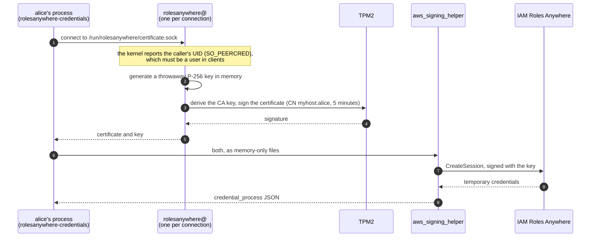

# rolesanywhere

Short-lived AWS credentials for the users of a NixOS machine through
[IAM Roles Anywhere](https://docs.aws.amazon.com/rolesanywhere/latest/userguide/introduction.html).
The machine's TPM2 holds a CA key that AWS trusts as a trust anchor, and an
issuer signs a 5-minute certificate for each request and logs it.



- **Identity:** the caller sends nothing. The socket admits only the
  `rolesanywhere-clients` group (the users in `clients`), and the issuer
  checks the list again against the UID the kernel reports for the connection.
- **Credential:** a certificate valid for 5 minutes and its throwaway key.
  `rolesanywhere-credentials` hands both to `aws_signing_helper` as memfds, so
  the key is written to no file.
- **Audit:** the issuer's journal logs each certificate's serial number with
  the user and process it went to, and Roles Anywhere names the AWS session
  after the same serial number.
- **CA key:** the TPM2 derives it from its owner hierarchy's seed and a policy
  on PCR 7, the Secure Boot state, so nothing is stored and the key cannot
  leave the TPM2. It signs only under the Secure Boot state it was derived in.
  After a Secure Boot change or a TPM2 clear, the TPM2 derives another key, and
  the issuer refuses until its CA certificate is registered.

## Use

`sudo rolesanywhere ca-certificate` on the machine prints a CA certificate for
its CA key. The certificate goes into the machine's trust anchor and into
`services.rolesanywhere`:

```nix
{
  services.rolesanywhere = {
    enable = true;
    clients = [ "alice" ];
    caCertificate = ./rolesanywhere-ca.pem;
  };
}
```

Each role trusts one exact subject from one trust anchor: its trust policy
matches `aws:SourceArn` and `aws:PrincipalTag/x509Subject/CN`. `alice` uses a
profile with the trust anchor's, the Roles Anywhere profile's and the role's
ARNs:

```ini
[profile myhost]
region = eu-west-1
credential_process = rolesanywhere-credentials --trust-anchor-arn <trust anchor ARN> --profile-arn <profile ARN> --role-arn <role ARN>
```

## Trust model

- **Identity is per Unix user.** Every process running as a client user can
  get that user's certificate.
- **Root on the machine can issue a certificate for any subject**, and so can
  anything that grants root: sudo rules, SSH agent forwarding, Nix
  `trusted-users`. The CA key never leaves the TPM2, so issuing ends with
  access to the machine.
- **AWS trusts one CA certificate**, the one in the trust anchor. Changing it
  takes AWS credentials that can update the trust anchor.
